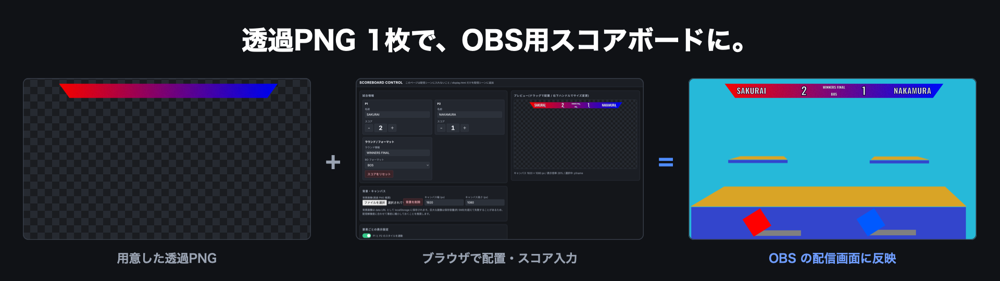
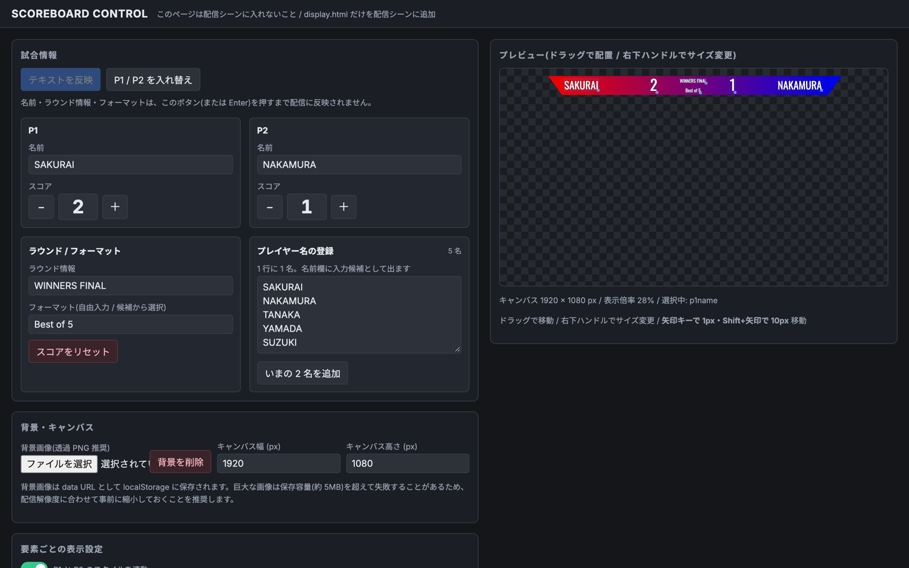

# Scoreboard Maker

OBS のブラウザソースだけで動く、格闘ゲーム配信用スコアボードツール。
プレイヤー名・スコア・ラウンド情報・BO フォーマットを、配信画面上の好きな位置・好きな見た目で表示できます。



サーバーもビルドも不要です。`npm install` も webpack も要りません。**HTML と JS を置くだけで動きます。**

---

## 特徴

- **素の HTML/CSS/JS のみ** — ファイルを置くだけ。ビルド環境ゼロ
- **ドラッグで自由配置** — 操作パネルのプレビュー上で要素をつかんで動かす。右下ハンドルでサイズ変更
- **見た目を細かく調整** — フォント6種 / 文字色 / 縁取り(色・太さ) / 文字の横幅(50〜150%)
- **P1・P2 のスタイル統一** — 「反対側にコピー」ボタンと「連動」トグルで左右のデザイン崩れを防止
- **透過 PNG を背景に** — 自作のスコアボード画像を読み込んで、その上に文字を載せられる
- **Google スプレッドシート連携** — 遠隔の協力者がシートを更新するだけでスコアが反映される(任意)

---

## ファイル構成

| ファイル | 役割 |
|---|---|
| `control.html` | 操作パネル。配置・スタイル調整・スコア操作を行う。**配信シーンには入れない** |
| `display.html` | 透過表示専用のスコアボード本体。**これを配信シーンに追加する** |
| `scoreboard-core.js` | 状態の初期値・保存・読み込み・マージ処理の共有ロジック |
| `assets/scoreboard-overlay.png` | サンプルのスコアボード画像(透過 PNG / 1920×1080) |
| `assets/hero.png` | README 冒頭のバナー |
| `assets/demo.png` | 配信画面での表示例 |
| `assets/control-panel.png` | 操作パネルのスクリーンショット |

3つのファイルは**同じフォルダに置いてください**。`control.html` と `display.html` は
`scoreboard-core.js` を相対パスで読み込みます。

---

## OBS 設定手順

**重要: `control.html` と `display.html` は、どちらも OBS の内蔵ブラウザ(CEF)で開いてください。**
同期は OBS 内蔵ブラウザの localStorage を共有することで成立しています。
外部の Chrome や Safari で `control.html` を開いても、OBS 側には反映されません。

OBS のカスタムブラウザドックとブラウザソースは同一の CEF プロファイル
(`plugin_config/obs-browser/`)を使うため、両者の localStorage は共有されます。

### 1. display.html を配信シーンに追加

1. ソース → `+` → **ブラウザ**
2. 「ローカルファイル」にチェックを入れ、`display.html` を選択
3. 幅・高さを、操作パネルで設定するキャンバスサイズと同じ値にする(例: 1920 × 1080)

### 2. control.html はカスタムブラウザドックで開く(推奨)

`[ドック]` → `[カスタムブラウザドック]` を開き、任意の名前と、**`file:///` から始まるフルパス**を入力します。

```
file:///Users/あなたの名前/Documents/scoreboard-maker/control.html
```

Windows の場合は `file:///C:/Users/.../control.html` です(スラッシュ3本)。

ドック方式には次の利点があります。

- ソース一覧に出ないので、**配信シーンに紛れ込む事故が起きない**
- シーンを切り替えても常に操作できる。右クリック →「操作」を開く手間が不要
- OBS を再起動しても復元される
- 画面に映らないため、ウィンドウサイズを自由に取れる

> ドックを使う場合、`control.html` をブラウザソースとしても追加する必要はありません。二重に登録しないでください。

<details>
<summary>ブラウザソースとして追加する方法(ドックを使わない場合)</summary>

1. `display.html` と同じ手順でブラウザソースを追加し、`control.html` を選択(幅 1600 × 高さ 1000 程度)
2. **配信シーンには含めないでください。** 専用の作業用シーンに置くか、ソース一覧の目玉アイコンを OFF にする
3. 操作するときは、そのソースを右クリック → **「操作」(Interact)** でウィンドウを開く

</details>

### 3. 使う

操作パネルで値を変えると、`display.html` 側は 0.5 秒以内に自動で追従します。
(`storage` イベントとポーリングの両方で変化を検知しています)

---

## 操作パネルの使い方



画面は左右2カラムです。**左でスクロールしながら設定を変え、右のプレビューは常に見えたまま**になります。
(ウィンドウ幅が 1000px 以下のときは1カラムになり、プレビューが上に移動します)

### 試合情報

- プレイヤー名の入力、スコアの `+` / `−`(0 未満にはなりません)
- ラウンド情報の自由入力、BO フォーマットの選択(BO1 / BO3 / BO5 / BO7)
- 「スコアをリセット」は**スコアだけ**を 0 に戻します。位置・スタイル・名前はそのまま

### 背景・キャンバス

- 透過 PNG をアップロードして背景に設定(data URL として保存されます)
- キャンバスの幅・高さを指定。`display.html` のブラウザソースのサイズと合わせてください

> 背景画像は localStorage に保存されるため、保存容量(約 5MB)の制約があります。
> 4K の画像などをそのまま入れると保存に失敗することがあるので、配信解像度に合わせて縮小してから読み込んでください。

### 要素ごとの表示設定

表示要素は次の6つです。

`P1 名前` / `P2 名前` / `P1 スコア` / `P2 スコア` / `ラウンド情報` / `BO フォーマット`

各要素について以下を調整できます。

| 項目 | 内容 |
|---|---|
| 表示 / 非表示 | ボタンで切り替え |
| 位置 | プレビュー上でドラッグ、または X / Y に数値入力 |
| サイズ | 右下ハンドルのドラッグ、またはスライダー |
| フォント | Oswald / Bebas Neue / Anton / Russo One / Noto Sans JP / Inter |
| 文字色 | カラーピッカー |
| 縁取り | 色と太さ(`-webkit-text-stroke` + `paint-order: stroke fill`) |
| 文字の横幅 | 50〜150%(`transform: scaleX()`)。狭いスペースに長い名前を収めるとき用 |

### P1 / P2 のスタイル統一

左右でフォントや色がバラバラになるのを防ぐ機能が2つあります。

- **「反対側にコピー」ボタン** — フォント / 文字色 / 縁取り / 縁取り色 / 横幅 / **サイズ** を反対側にコピーします。**位置(X, Y)はコピーしません**
- **「P1 と P2 のスタイルを連動」トグル** — ON の間、片方のスタイルを変えるともう片方にも自動で反映されます。こちらは**サイズと位置は対象外**です(ハンドルでの拡縮が左右同時に起きると事故りやすいため)

---

## Google スプレッドシート連携(任意)

配信者本人以外(遠隔の協力者など)がスプレッドシートを更新するだけで、スコアボードに反映できます。

### 1. シートを用意する

シート名を `Scoreboard` にして、1行目にカラム名、2行目に値を入れます。

| A | B | C | D | E | F |
|---|---|---|---|---|---|
| p1name | p2name | p1score | p2score | round | bo |
| Player1 | Player2 | 2 | 1 | ROUND 1 | BO3 |

### 2. Apps Script をデプロイする

`[拡張機能]` → `[Apps Script]` を開き、以下を貼り付けて保存します。

```javascript
var SHEET_NAME = 'Scoreboard';

function doGet(e) {
  var sheet = SpreadsheetApp.getActiveSpreadsheet().getSheetByName(SHEET_NAME);
  var values = sheet.getDataRange().getValues();
  var headers = values[0];   // 1 行目 = カラム名
  var row = values[1] || []; // 2 行目 = 現在の値

  var out = {};
  for (var i = 0; i < headers.length; i++) {
    var key = String(headers[i]).trim();
    if (!key) continue;
    out[key] = row[i];
  }
  out.updatedAt = new Date().toISOString();

  return ContentService
    .createTextOutput(JSON.stringify(out))
    .setMimeType(ContentService.MimeType.JSON);
}
```

`[デプロイ]` → `[新しいデプロイ]` → 種類「ウェブアプリ」で、

- 次のユーザーとして実行: **自分**
- アクセスできるユーザー: **全員**

としてデプロイし、発行された `/exec` で終わる URL をコピーします。

### 3. 操作パネルに設定する

URL を入力欄に貼り、「同期 ON」トグルを入れます。以降 **7 秒ごと**にシートを取得します。

- 反映されるのは `p1name` / `p2name` / `p1score` / `p2score` / `round` / `bo` のみです
- **位置やスタイルは同期対象外**です。シート側に余計な列があっても無視されます
- 数値は 0 未満に丸められ、`bo` は BO1 / BO3 / BO5 / BO7 以外の値なら無視されます
- **競合したときはシートの値が優先**されます。手元だけで操作したいときは同期を OFF にしてください

> ### ⚠ セキュリティについて
> アクセス「全員」でウェブアプリを公開すると、**URL を知っている人は誰でもシートの内容を読み取れます。**
> URL を配信画面に映したり、公開の場所に貼ったりしないでください。
> また、シートの編集権限を渡した相手は当然スコアを書き換えられます。機密情報はこのシートに置かないこと。

---

## データの保存場所

状態は localStorage のキー `scoreboard_state_v1` に JSON で保存されます。

読み込み時はデフォルト値とディープマージされるため、**古い保存データでも新しいフィールドが自動的に補完されます。**
設定を全部やり直したいときは、`control.html` を「操作」で開いた状態で DevTools から次を実行してください。

```javascript
localStorage.removeItem('scoreboard_state_v1');
```

---

## トラブルシューティング

| 症状 | 原因と対処 |
|---|---|
| 配信画面が白い四角で覆われる | 背景に**アルファチャンネルの無い PNG**(背景が白く塗られた画像)を読み込んでいます。プレビューが市松模様ではなく真っ白なら確実にこれです。透過 PNG に差し替えてください |
| display に反映されない | `control.html` を OBS 外のブラウザで開いていませんか。カスタムブラウザドックか OBS のブラウザソース、どちらかで開く必要があります |
| ドックとソースで同期しない | 両方の URL のオリジンを揃えてください。片方が `file://`、もう片方が `http://localhost` だと localStorage は共有されません |
| 背景画像が保存できない | 画像が大きすぎます。配信解像度まで縮小してください(localStorage の上限は約 5MB) |
| 文字がフォント変更に追従しない | Google Fonts の読み込みにネットワークが必要です。OBS がオフラインだと既定フォントで表示されます |
| シート同期が失敗する | ウェブアプリのアクセス設定が「全員」になっているか、URL が `/exec` で終わっているか確認してください |
| 縁取りが文字を潰す | 太さを下げるか、フォントサイズを上げてください |

---

## 同梱アセットについて

`assets/scoreboard-overlay.png` は、`control.html` の「背景画像」にそのまま読み込めるサンプルです
(1920×1080 の透過 PNG)。読み込んだうえで、キャンバスを 1920×1080 に設定してお使いください。

`assets/demo.png` はゲーム画面のイメージとスコアボード画像を合成した表示例です。

フォントは Google Fonts から読み込んでいます(いずれも SIL Open Font License)。

---

## 動作確認環境

- OBS Studio 32.2.1 (macOS)
- `control.html` をカスタムブラウザドック(`file:///...`)、`display.html` をブラウザソース(ローカルファイル)として登録した構成で同期を確認済み
